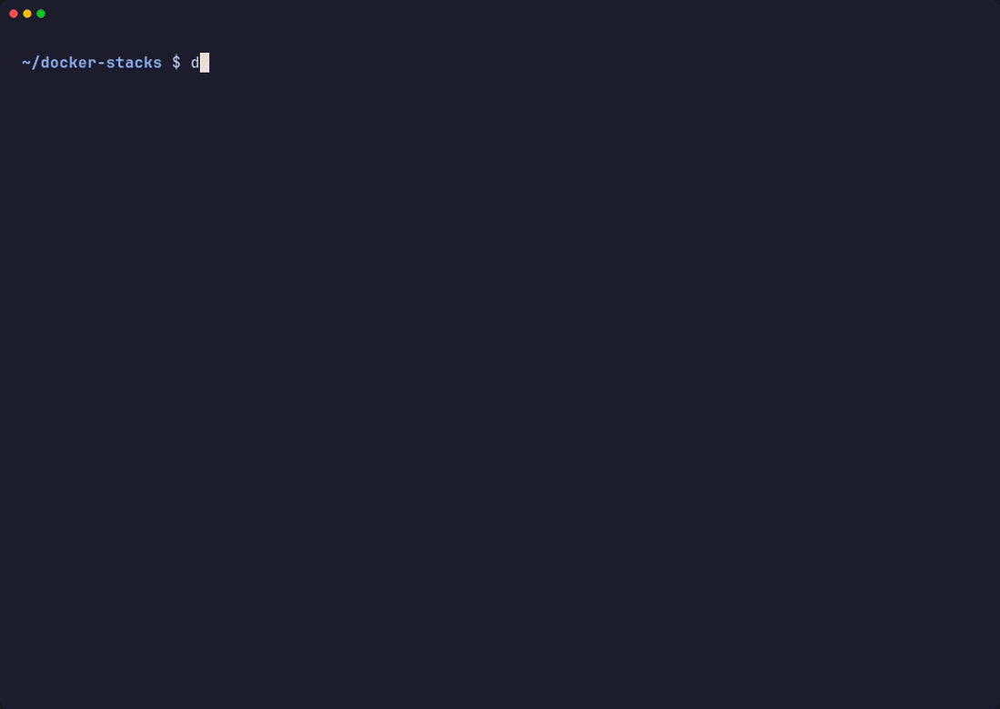
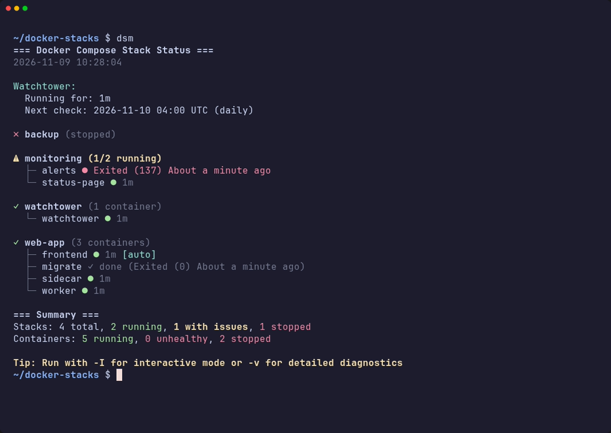
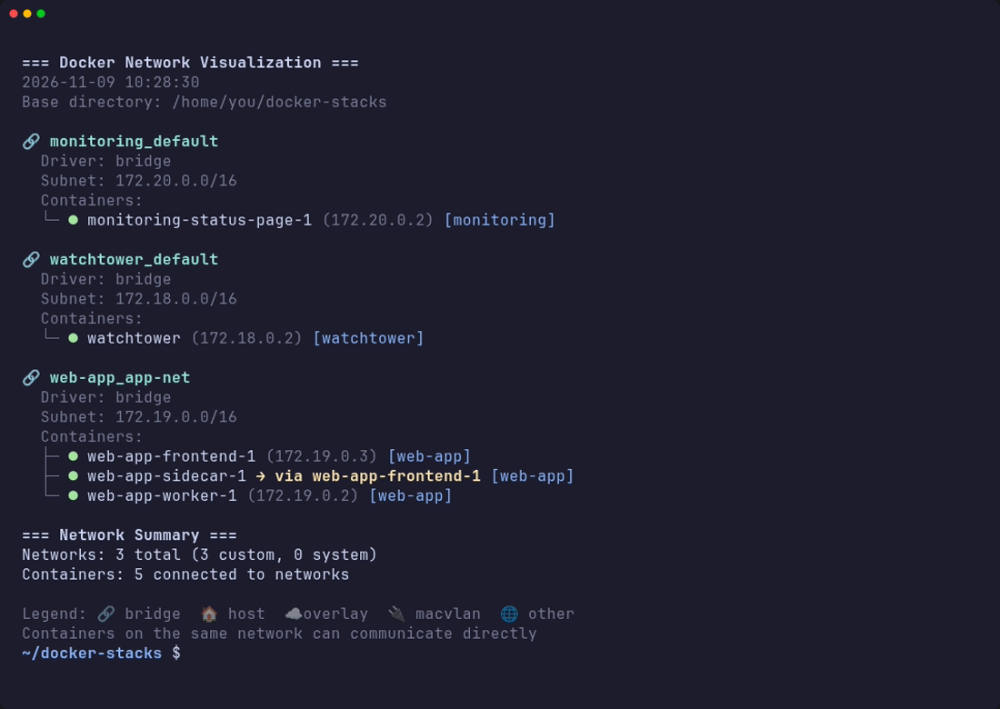
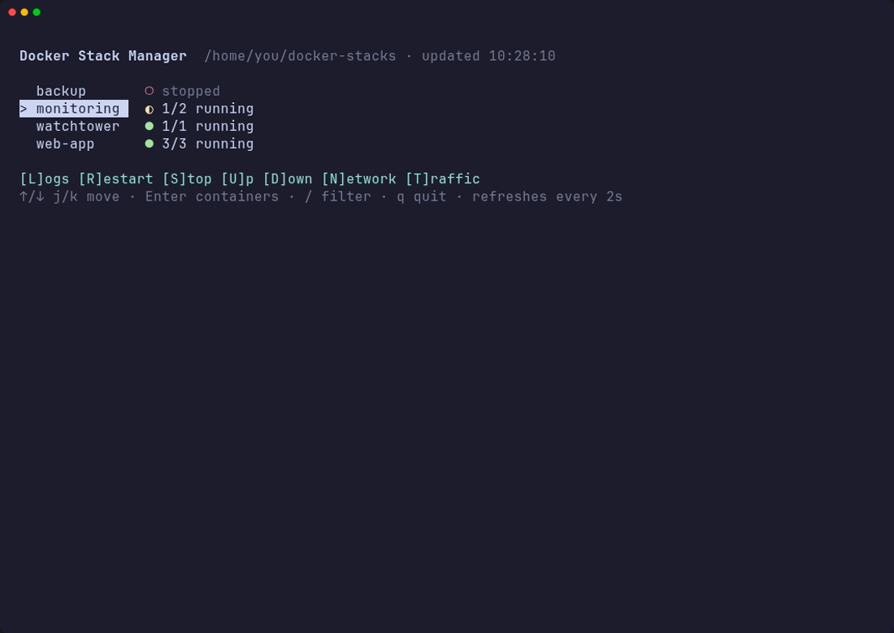
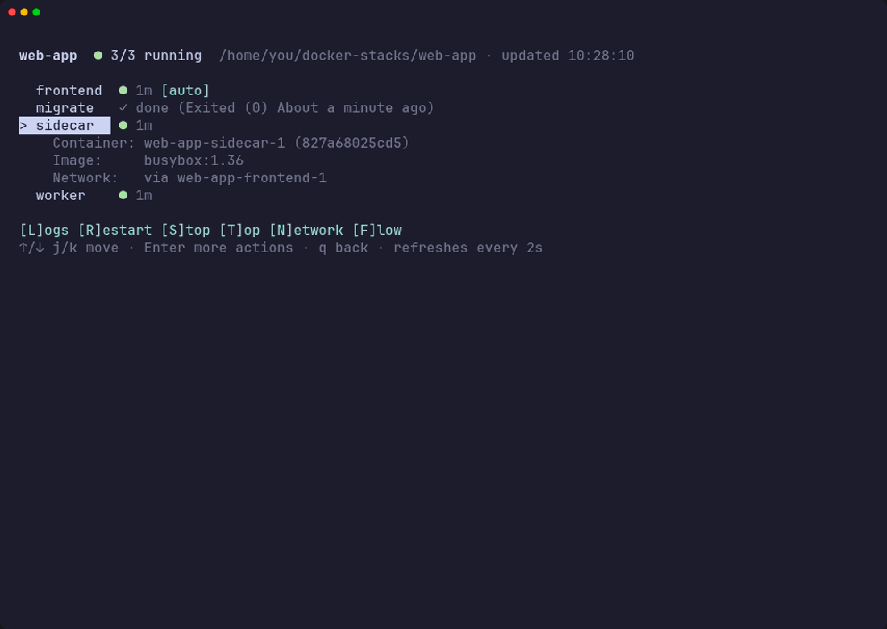

<h1 align="center">🐳 Docker Stack Manager</h1>

<p align="center">
  <strong>See and control every Docker Compose stack on a host from one terminal UI.</strong><br>
  One script: bash or zsh for Linux and macOS, native PowerShell for Windows. No daemon, no web server, no database.
</p>

<p align="center">
  <a href="https://github.com/datstma/docker-stacks-manager/actions/workflows/ci.yml"></a>
  <a href="https://github.com/datstma/docker-stacks-manager/releases/latest"></a>
  
  
  
  
  <a href="LICENSE"></a>
</p>

<p align="center">
  <a href="#-install">Install</a> •
  <a href="#-usage">Usage</a> •
  <a href="#-interactive-mode">Interactive mode</a> •
  <a href="#-import-docker-run--compose">Import</a> •
  <a href="#-windows-powershell">Windows</a> •
  <a href="#-updating">Updating</a> •
  <a href="#-faq--troubleshooting">FAQ</a> •
  <a href="#-contributing">Contributing</a>
</p>

<p align="center">
  
</p>

If your homelab or server is a directory full of `docker-compose.yaml` files, this is the tool for
the moment you SSH in and want to know *what's running, what isn't, and why*, then restart or
tail the thing that broke, without opening a browser. Think [Dockge](https://github.com/louislam/dockge)
or Portainer's stack view, but in your terminal, with vim keys.

## ✨ Features

- **Every stack at a glance**: running, partly running, unhealthy or stopped, with uptime, health
  and restart counts. Crash-looping containers stand out (`↻3`)
- **Knows the difference** between a crashed service and a one-shot job (a migration, a backup)
  that finished cleanly: the job shows as `✓ done`, not as a problem
- **Interactive TUI**: `j`/`k` or arrows, `Enter` to drill into a stack, `/` to filter. Live logs,
  restart, stop, up, down, a shell in a container, `top`, stats. Anything destructive asks first
- **Live and flicker-free**: refreshes itself every few seconds while you watch, on the terminal's
  alternate screen, so your scrollback is untouched when you quit
- **Fast**: three `docker` calls in total, however many stacks you have. 20+ stacks load in about
  half a second
- **Network view**: networks, subnets and IPs, and which containers share another container's
  network (an app routed through a VPN container, a sidecar)
- **Watchtower aware**: when Watchtower last ran, what it updated or couldn't check, when it
  runs next, and which containers have opted in to auto-updates (`[auto]`)
- **Import into compose**: turn a container you started with `docker run`, or a `docker run`
  command you paste, into a compose stack. You see the file first; dsm can then switch the
  container over, keeping its volumes and data, and puts it back if anything fails.
  [More](#-import-docker-run--compose)
- **Linux, macOS and Windows**: a shell script for Linux, macOS and WSL2 (bash or zsh, so macOS
  needs nothing extra), and a native [PowerShell edition](#-windows-powershell) for Windows with
  Docker Desktop. Same views, same keys. Nothing to install besides Docker

## 📸 Screenshots

<table>
<tr>
<td width="50%"></td>
<td width="50%"></td>
</tr>
<tr>
<td align="center"><b>Status overview</b> (<code>dsm</code>)</td>
<td align="center"><b>Network view</b> (<code>dsm -n</code>)</td>
</tr>
<tr>
<td width="50%"></td>
<td width="50%"></td>
</tr>
<tr>
<td align="center"><b>Interactive TUI</b> (<code>dsm -I</code>)</td>
<td align="center"><b>Inside a stack</b> (<code>Enter</code>)</td>
</tr>
</table>

All screenshots are real output from the bundled [demo stacks](#-try-it-on-the-demo-stacks),
recorded with [`demo/screenshots/screenshots.sh`](demo/screenshots/screenshots.sh).

## 🚀 Install

**Linux, macOS, WSL2** (one line):

```bash
curl -fsSL https://raw.githubusercontent.com/datstma/docker-stacks-manager/main/install.sh | bash
```

This installs the latest release as `docker-stacks-manager` in `~/.local/bin` (or `/usr/local/bin`
when run as root) with a short `dsm` alias next to it, and tells you if that directory isn't on
your `PATH` yet. Prefer to read it before running it? It's [short](install.sh):

```bash
curl -fsSLO https://raw.githubusercontent.com/datstma/docker-stacks-manager/main/install.sh
less install.sh
bash install.sh
```

<details>
<summary><strong>Installer options</strong></summary>

| Option | Environment | Meaning |
|---|---|---|
| `--prefix DIR` | `DSM_PREFIX` | Install into `DIR/bin`. Default `~/.local`, or `/usr/local` as root |
| `--ref REF` | `DSM_REF` | Install a specific release tag or branch, e.g. `v1.0.0` or `main` |
| `--uninstall` | | Remove an installed copy (use the same `--prefix`) |

Pass options through the pipe with `bash -s --`:

```bash
curl -fsSL https://raw.githubusercontent.com/datstma/docker-stacks-manager/main/install.sh | sudo bash -s -- --prefix /usr/local
```
</details>

<details>
<summary><strong>From a git clone</strong> (to hack on it, or to update with <code>git pull</code>)</summary>

```bash
git clone https://github.com/datstma/docker-stacks-manager.git
cd docker-stacks-manager
./install.sh             # installs this clone's script; or just run ./docker-stacks-manager.sh
make install             # the same, for those who prefer make (PREFIX=/usr/local to change)
```
</details>

<details>
<summary><strong>Manually</strong> (it's one file)</summary>

```bash
curl -fsSL -o ~/.local/bin/dsm \
  https://raw.githubusercontent.com/datstma/docker-stacks-manager/main/docker-stacks-manager.sh
chmod +x ~/.local/bin/dsm
```
</details>

**Windows** (PowerShell, one line):

```powershell
irm https://raw.githubusercontent.com/datstma/docker-stacks-manager/main/install.ps1 | iex
```

This installs the PowerShell edition and a `dsm` command into
`%LOCALAPPDATA%\Programs\docker-stacks-manager` and adds it to your user `PATH`. Open a new
terminal and run `dsm`. More in [Windows (PowerShell)](#-windows-powershell).

### Requirements

| | |
|---|---|
| **Shell** | bash 4.0+ or zsh 5.1+. On macOS, whose bash is 3.2, the script runs itself under the built-in zsh: nothing to install |
| **PowerShell** (Windows) | Windows PowerShell 5.1, which every Windows 10/11 has, or PowerShell 7+ |
| **Docker** | With the Compose v2 plugin (`docker compose`). The old standalone `docker-compose` v1 is not supported |
| **Tools** | `awk`, `sed`, `grep`, `find`, `sort` and friends, present on any normal system. `bc` is optional |
| **Install/update** | `curl` or `wget` (Linux/macOS); nothing extra on Windows |

## 📖 Usage

Run it from the directory that holds your stacks, or point it there with `-d`:

```bash
cd ~/docker-stacks && dsm -I     # interactive TUI
dsm -d ~/docker-stacks           # status overview of a given directory
export DSM_DIR=~/docker-stacks   # ...or set it once in your shell profile
```

A **stack** is any directory containing `compose.yaml`, `compose.yml`, `docker-compose.yaml` or
`docker-compose.yml`: the base directory itself and its direct subdirectories. If a directory has
more than one, the file `docker compose` itself would pick wins.

```
~/docker-stacks/          ← run dsm here
├── media/
│   └── compose.yaml
├── monitoring/
│   └── docker-compose.yml
└── proxy/
    └── docker-compose.yaml
```

```
Views:
  -I, --interactive  Interactive TUI (recommended)
  -v, --verbose      Status with CPU/memory, ports and images
  -s, --stats        Status with CPU/memory
  -p, --ports        Status with port mappings
  -i, --images       Status with image versions
  -w, --watch        Redraw the status every 5 seconds
  -n, --network      Networks and the containers on them

Import (turn plain docker containers into compose stacks, guided):
  --import NAME      Convert a container started with docker run; without
                     NAME, lists the containers compose doesn't manage
  --convert CMD...   Convert a docker run command: the rest of the line, or
                     read from stdin. Must come last
  --print            With --import/--convert: only print the compose file

Options:
  -d, --dir DIR      Directory holding your stacks (default: current directory)
  -U, --update       Update this script to the latest release
  -V, --version      Print the version
  -h, --help         Show this help

Environment:
  DSM_DIR            Default for --dir
  DSM_REFRESH        TUI refresh interval in seconds (default 5)
```

With `-v`, each container also gets its CPU/memory, ports and image:

```
✓ web-app (3 containers)
  ├─ frontend ● 12m [auto]
  │  CPU: 0.00%  MEM: 488KiB
  │  Ports: 8080/tcp -> 18080
  │  Image: busybox:1.36
  ├─ migrate ✓ done (Exited (0) 12 minutes ago)
  │  Image: busybox:1.36
  └─ worker ● 12m
     CPU: 0.00%  MEM: 488KiB
     Image: busybox:1.36
```

## 🎮 Interactive mode

`dsm -I` opens the TUI. It refreshes itself every 5 seconds while idle (`DSM_REFRESH` to change).

| Key | Stack list | Inside a stack |
|---|---|---|
| `↑` `↓` / `j` `k` | Move | Move |
| `Enter` | Open the stack's containers | Action menu for the container |
| `/` | Filter stacks by name, `Enter` to apply (`Esc` clears) | |
| `L` | Live logs of the whole stack | Container logs |
| `R` | Restart the stack ✋ | Restart the container ✋ |
| `S` | Stop the stack ✋ | Stop the container ✋ |
| `U` | Start it (`docker compose up -d`) | |
| `D` | Down: remove its containers ✋ | |
| `T` | Live traffic per container | `top` inside the container |
| `N` | Network view | Network and ports |
| `I` | [Import](#-import-docker-run--compose) a container or a `docker run` command | |
| `F` | | Live stats (CPU, memory, network) |
| `q` | Quit | Back |
| `Ctrl+C` | Quit | Leave a live view (logs, stats) and return to the menu |

✋ asks for confirmation first: only `y` goes ahead.

The container action menu (`Enter` on a container) adds both log modes (live and last 100 lines),
start, a shell (`bash` or `sh`), `top` and live stats.

**Status symbols**

| | |
|---|---|
| `●` green | Running (and healthy, if it has a healthcheck) |
| `●` yellow | Healthcheck still starting |
| `●` red | Unhealthy or stopped |
| `◐` | Stack partly running: something that should run doesn't |
| `○` | Stack stopped |
| `✓ done` | One-shot job that exited with code 0 and isn't meant to restart |
| `↻N` | Restarted N times: probably crash-looping |
| `[auto]` | Opted in to Watchtower auto-updates |

## 📥 Import: docker run → compose

Containers started with `docker run` are easy to lose track of: the command is gone, and so is
what it set. dsm turns them into compose stacks, from a running (or stopped) container or from a
`docker run` command you paste:

```bash
dsm --import                      # list the containers compose doesn't manage
dsm --import nginx                # convert one, guided
dsm --convert docker run -d --name web -p 8080:80 -v web-data:/usr/share/nginx/html nginx:1.27
dsm --import nginx --print        # just print the compose file
pbpaste | dsm --convert           # read the command from stdin (prints the file)
```

In the TUI, press `I` for the same: pick a container, or paste a command (multi-line commands with
`\` continuations work).

**What you get.** For a container, dsm reads `docker inspect` and leaves out everything that
came from the image (its environment, labels, command), so the file holds what was actually set:
ports, volumes and bind mounts, environment, labels, restart policy, networks with static IPs and
aliases, capabilities, devices, limits, healthcheck, logging and so on. Existing named volumes
and networks are declared `external`, so compose uses them as they are and `docker compose down
-v` can't delete your data. `$` in values is escaped so compose doesn't try to fill it in.
Anything that has no compose equivalent (`--rm`, `-P`, ...) is listed as a note at the top of the
file.

```yaml
# Generated by docker-stacks-manager 1.2.0 from the container "web"
# Review it before use; `docker compose config` checks it.
services:
  web:
    image: "nginx:1.27-alpine"
    container_name: "web"
    restart: "unless-stopped"
    ports:
      - "8080:80"
    volumes:
      - "web-data:/usr/share/nginx/html"
    environment:
      - "TZ=Europe/Stockholm"
volumes:
  "web-data":
    external: true
```

**The guided part.** dsm shows the file, asks for a stack folder name (in your stacks directory)
and writes `compose.yaml` there only when you say so. For a container, it then offers to switch
over:

1. the container is stopped and kept as `<name>-pre-compose`, with its restart policy off so it
   doesn't come back on reboot
2. the stack starts with `docker compose up -d`, on the same volumes, so the data is there
3. if the stack fails to start, the original container gets its name, restart policy and state
   back, and the `compose.yaml` stays for you to fix

Once you're happy, remove the old container with `docker rm <name>-pre-compose`. Anonymous
volumes (a `VOLUME` in the image that you never named) are kept by their ID, so even their data
carries over. For a pasted command, dsm offers to start the stack, creating any external networks
and volumes it uses that don't exist yet.

## 🪟 Windows (PowerShell)

On Windows, dsm is a native PowerShell script: no WSL, Git Bash or Cygwin needed, just Docker
Desktop. It works in Windows Terminal and the classic console, with Windows PowerShell 5.1 or
PowerShell 7 (it uses 7 when it's installed).

Everything above applies; the options are PowerShell parameters. The short Bash-style aliases
work too, so `dsm -I` and `dsm -v` do what you'd expect:

| PowerShell | Alias | Bash |
|---|---|---|
| `-Interactive` | `-I` | `-I`, `--interactive` |
| `-Detailed` | `-v` | `-v`, `--verbose` |
| `-Stats` / `-Ports` / `-Images` | `-s` / `-p` | `-s` / `-p` / `-i` |
| `-Watch` | `-w` | `-w` |
| `-Network` | `-n` | `-n` |
| `-Dir C:\docker-stacks` | `-d` | `-d DIR` |
| `-Update` | `-U` | `-U`, `--update` |
| `-Version` | | `-V`, `--version` |
| `-Import NAME` | | `--import NAME` |
| `-Convert 'docker run ...'` (quoted; `-` reads stdin) | | `--convert docker run ...` |
| `-Print` | | `--print` |

```powershell
cd C:\docker-stacks; dsm -Interactive
dsm -Dir C:\docker-stacks -Detailed
$env:DSM_DIR = 'C:\docker-stacks'     # or set it permanently in your profile
dsm -Help                              # all options
```

In the TUI, `q`, `Esc` or `Ctrl+C` leave a live view (logs, stats, traffic) and take you back to
the menu. The filter (`/`) narrows the list as you type.

`-Convert` understands commands written for any shell: `\` (sh), `` ` `` (PowerShell) and `^`
(cmd) line continuations, and Windows paths such as `-v C:\data:/data`. Pipe one in with
`Get-Clipboard | dsm -Convert -`.

<details>
<summary><strong>How the Windows install works</strong></summary>

- The script goes into `%LOCALAPPDATA%\Programs\docker-stacks-manager`, next to a `dsm.cmd`
  launcher. The launcher runs PowerShell 7 if you have it, otherwise Windows PowerShell 5.1,
  with `-ExecutionPolicy Bypass` for this one script, so your execution policy stays as it is
- That folder is added to your user `PATH`; terminals opened afterwards find `dsm`
- Installer options go through a script block:
  ```powershell
  & ([scriptblock]::Create((irm https://raw.githubusercontent.com/datstma/docker-stacks-manager/main/install.ps1))) -Ref v1.1.0
  ```
  `-Ref` picks a release or branch, `-Destination` another folder, `-Uninstall` removes it
  (folder and `PATH` entry)
- From a clone: `.\install.ps1`, or run `.\docker-stacks-manager.ps1` directly
</details>

## 🔄 Updating

```bash
dsm --update
```

downloads the latest release and replaces the installed script in place, after checking that the
download is a valid script. If you run it from a git clone of this repository, it does a
`git pull --ff-only` instead. Running the installer again also updates. To get a specific
version, use `DSM_UPDATE_REF=v1.0.0 dsm --update` or the installer's `--ref`.

If the script lives somewhere only root can write (`/usr/local/bin`), use `sudo dsm --update`.

On Windows, `dsm -Update` does the same for the PowerShell edition, and running the
`irm … | iex` line again also updates.

To uninstall:

```bash
curl -fsSL https://raw.githubusercontent.com/datstma/docker-stacks-manager/main/install.sh | bash -s -- --uninstall
```

```powershell
& ([scriptblock]::Create((irm https://raw.githubusercontent.com/datstma/docker-stacks-manager/main/install.ps1))) -Uninstall
```

## 🧪 Try it on the demo stacks

`demo/` has three throwaway stacks (busybox only, ports 18080 and 18081) that between them show
every state: running, partly running, stopped, a finished one-shot job and a sidecar sharing
another container's network.

```bash
git clone https://github.com/datstma/docker-stacks-manager.git && cd docker-stacks-manager
./demo/demo.sh up       # start the demo stacks (backup is created but left stopped)
./demo/demo.sh run -I   # run dsm on them, with any options
./demo/demo.sh down     # remove them again
```

On Windows: `.\demo\demo.ps1 up`, `.\demo\demo.ps1 run -Interactive`, `.\demo\demo.ps1 down`.

## 🖥️ Platforms

| Platform | Notes |
|---|---|
| **Linux** | Any distro with bash 4+ or zsh. Used daily on Debian |
| **macOS** | Docker Desktop, OrbStack or Colima. Nothing else: macOS's bash is 3.2, too old, so the script hands itself over to the zsh every Mac has. A newer bash from Homebrew is used when it's first on your `PATH` |
| **Windows** | The [PowerShell edition](#-windows-powershell) with Docker Desktop, on Windows PowerShell 5.1 or PowerShell 7 |
| **Windows, WSL2** | The Bash script, inside a WSL2 distro with Docker Desktop's WSL integration. Behaves exactly like Linux |

CI runs the shell tests on Linux and macOS, under both bash and zsh (and checks that macOS's own
bash 3.2 hands over to zsh), and the PowerShell tests on Windows under both PowerShell 5.1 and 7,
on every push.

## ❓ FAQ & troubleshooting

<details>
<summary><strong>"No stacks found"</strong></summary>

dsm looks in the current directory (or `-d DIR` / `$DSM_DIR`) and its direct subdirectories for
`compose.yaml`, `compose.yml`, `docker-compose.yaml` or `docker-compose.yml`. Stacks nested deeper
than one level aren't picked up.
</details>

<details>
<summary><strong>A stack I started from elsewhere doesn't show its containers</strong></summary>

Containers are matched to stacks by the working directory Compose records on them, then by
project name. If you started a stack with `-p someothername` from another directory, neither
matches. Start it from its own directory with `docker compose up -d`.
</details>

<details>
<summary><strong>"This script needs bash 4.0 or higher, or zsh"</strong></summary>

Your bash is older than 4.0 and there's no zsh to hand over to. Every Mac has zsh, so this means
a stripped-down system: install zsh or a newer bash (`apk add bash`, `apt install zsh`, ...).
</details>

<details>
<summary><strong>Import: is it safe to switch a container over?</strong></summary>

The original container is never deleted: it's stopped, renamed to `<name>-pre-compose` and kept
until you remove it yourself, and if the new stack doesn't start it is put back as it was. The
compose file uses your existing volumes as they are. Still, read the file before you switch: the
notes at its top say what couldn't be converted.
</details>

<details>
<summary><strong>Windows: symbols show as <code>?</code> or boxes</strong></summary>

The classic console's default font lacks some symbols. Windows Terminal (the default on Windows
11) shows them all; in the classic console, pick a font such as Cascadia Mono. The emoji in the
network view need Windows Terminal.
</details>

<details>
<summary><strong>Windows: "running scripts is disabled on this system"</strong></summary>

You ran the `.ps1` directly under a restrictive execution policy. Use the `dsm` command the
installer sets up (it bypasses the policy for this script only), or allow local scripts for your
account: `Set-ExecutionPolicy -Scope CurrentUser RemoteSigned`.
</details>

<details>
<summary><strong>WSL2: <code>$'\r': command not found</code></strong></summary>

The Bash script was saved with Windows line endings. The repository's `.gitattributes` prevents
this for fresh clones and the installer downloads it as-is; to fix an existing copy:
`sed -i 's/\r$//' docker-stacks-manager.sh`.
</details>

<details>
<summary><strong>"Missing required commands: docker compose (v2 plugin)"</strong></summary>

You have Docker but not the Compose plugin, or only the legacy `docker-compose` v1. Install the
plugin: on Debian/Ubuntu `sudo apt install docker-compose-plugin`; Docker Desktop includes it.
</details>

<details>
<summary><strong>Permission denied talking to Docker</strong></summary>

Add yourself to the `docker` group, then log out and back in:
`sudo usermod -aG docker $USER`.
</details>

<details>
<summary><strong>Traffic view shows "--"</strong></summary>

Normal for the first few seconds: a rate needs two samples.
</details>

<details>
<summary><strong>Does it send anything anywhere?</strong></summary>

No. It only talks to your local Docker. The one exception is `--update`, which asks GitHub for
the latest release when you run it.
</details>

## 🤝 Contributing

Issues and pull requests are welcome. The tool is two single-file editions that behave the same:
[docker-stacks-manager.sh](docker-stacks-manager.sh) (Bash) and
[docker-stacks-manager.ps1](docker-stacks-manager.ps1) (PowerShell). A change to one usually
belongs in the other too.

```bash
./tests/run.sh          # Bash tests: no Docker needed, they replay recorded docker output
make lint               # shellcheck (errors only), if you have shellcheck installed
./tests/record.sh       # re-record the fixtures when you change which docker commands are called
```

```powershell
Invoke-Pester ./tests/powershell     # PowerShell tests (Pester 5+), also without Docker
./tests/powershell/record.ps1        # re-record their fixtures (needs Docker Desktop)
```

For the shell script:

- It runs under bash 4+ and zsh (in its ksh mode). Use the helpers for what differs:
  `read_char` instead of `read -n`, `read_array` instead of `read -a`, `keys_of` instead of
  `${!array[@]}`, `lower` instead of `${x,,}`. Write `${s:$i:1}`, not `${s:i:1}`; no quotes
  inside array subscripts (`a[$k]=`, not `a["$k"]=`); `$NL` instead of `$'\n'` inside `${...}`.
  `./tests/run.sh` runs everything under zsh too when it's installed
- Avoid GNU-only flags: no `sed -r`, `grep "a\|b"` (use `grep -E`), `sort -h`, `readlink -f`, or
  `date -d` without a BSD fallback
- New views read the snapshot (`load_snapshot`) rather than calling `docker` per stack or per
  container: that's what keeps it fast
- On macOS? Running `./tests/run.sh` and reporting the result is a real help

For the PowerShell script:

- It has to run on Windows PowerShell 5.1: no `??`, `?.`, ternaries or `&&`. `.ps1` files with
  non-ASCII text are saved as UTF-8 **with BOM**, except `install.ps1`, which must stay plain
  ASCII without one because it runs through `irm | iex` (CI checks this, and that both editions
  agree on the version)
- docker output is read as JSON (`--format '[{{json .A}},{{json .B}}]'`), with no double quotes
  in templates: 5.1 mangles quotes in arguments to native programs

See [CHANGELOG.md](CHANGELOG.md) for what changed between releases.

## 📜 License

[MIT](LICENSE). Inspired by [Dockge](https://github.com/louislam/dockge); built for people who'd
rather stay in the terminal.

<p align="center"><sub>If it saves you a trip to a web UI, consider giving it a ⭐</sub></p>
